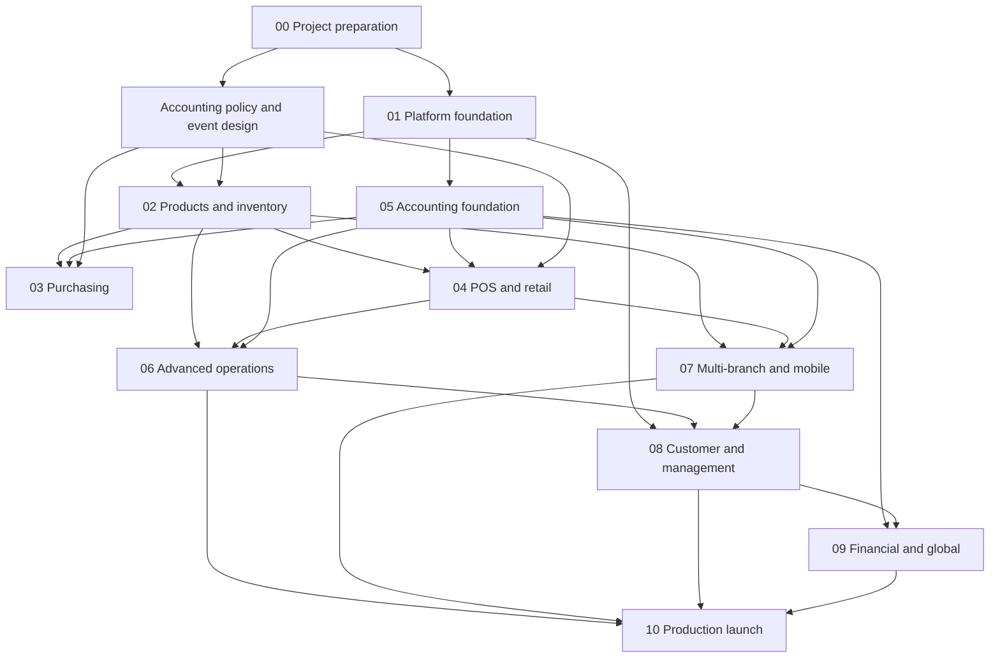

# Development Dependency Map

Accounting policy, event mapping and posting contracts begin during Phases 00/01. Phase 05 is not permission to defer financial integrity until later. Parallel work requires explicit module ownership, stable API/event contracts, schema ownership and integration tests.
