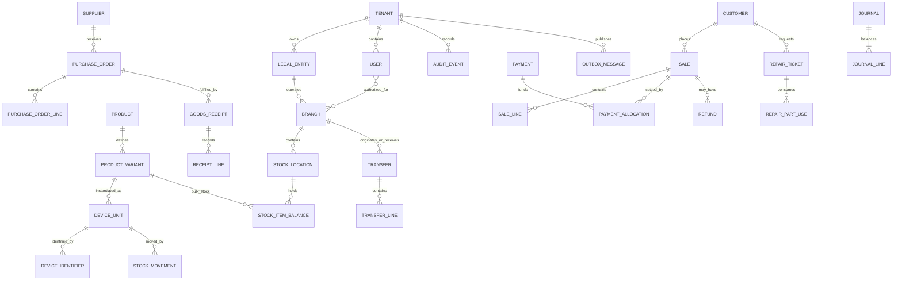

# Conceptual Database Relationships

**Status:** conceptual map, not a final ERD. Cardinalities are indicative; optionality and physical FK design require review.

## Relationship rules

- All tenant-owned tables are tenant-scoped, even when the diagram omits `tenant_id` for readability.
- Legal entity and branch references must be validated against the same tenant.
- A sale line may reference a bulk variant/quantity or a specific serialized `DeviceUnit`; model these as explicit line types or a reviewed polymorphic association, not an ambiguous nullable field combination.
- Payment and payment allocation are separate: one payment can settle multiple documents and one sale can be settled by multiple tenders.
- A repair ticket references customer-owned equipment independently from shop-owned inventory.
- Transfers connect source and destination branches; transfer lines retain dispatch and receipt quantities/status separately.
- Journal lines belong to exactly one journal; journal totals must balance under the configured accounting policy.
- Outbox/inbox records carry aggregate identity and version, but must not become a substitute for domain records.

## Physical design review checklist

- [ ] Every FK crossing a tenant boundary is prevented by composite keys or equivalent validation.
- [ ] RLS policies cover reads, writes, background jobs and support tools.
- [ ] Unique constraints align with tenant/global identifier decisions.
- [ ] Delete behaviour is explicit; ledger and audit records are not cascade-deleted.
- [ ] Indexes support branch/date/status and tenant-scoped access patterns.
- [ ] High-volume movement and journal tables have a partitioning review before scale requires it.
- [ ] Migrations are tested against production-like data volume.
