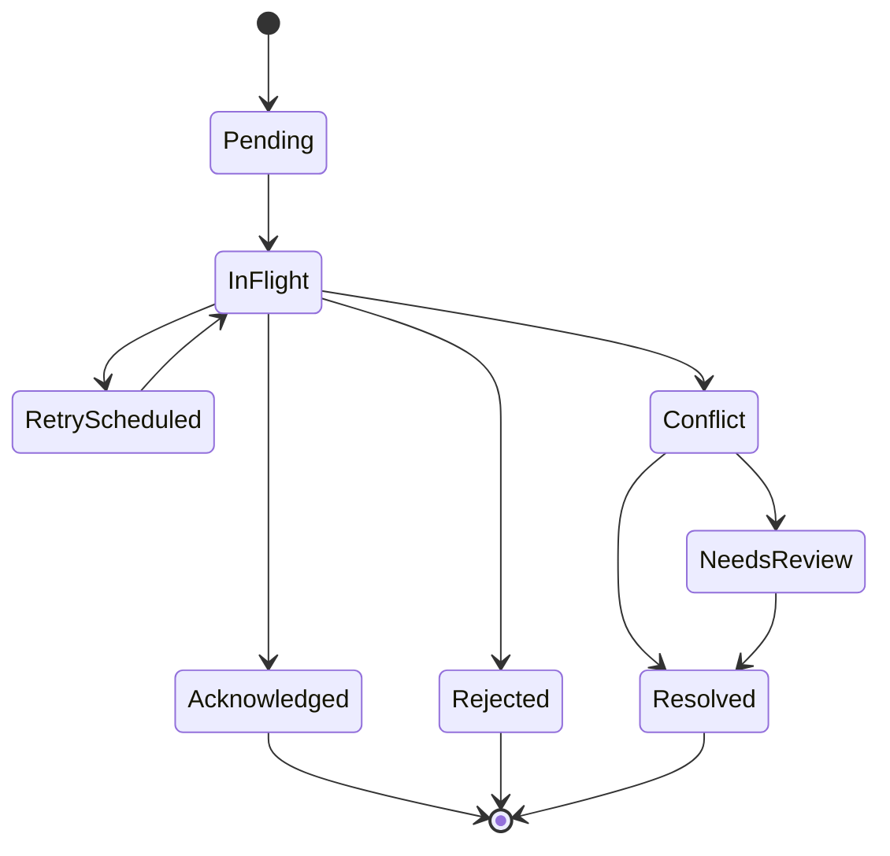

# Offline Synchronization Protocol

**Status:** proposed protocol baseline. Exact command allowlist and conflict policy must pass AG-08 before offline writes are enabled.

## 1. Core guarantee and limitation

The system provides durable, retryable, deduplicated synchronization with explicit conflict handling. It cannot guarantee global exclusivity while a device is disconnected. Two offline POS devices may independently believe the same scarce item is available. High-risk operations must be restricted, reserved online in advance, or sent for review when conflict is detected.

## 2. Local persistence

- Use encrypted SQLite and protect encryption keys with platform secure storage.
- Persist local business changes and an outbox command in one local database transaction.
- Assign a stable random `commandId` before the first attempt; never regenerate it on retry.
- Maintain per-device sequence numbers for ordering/diagnostics, not as a substitute for idempotency.
- Keep a durable sync cursor and last acknowledged server version.
- Do not place secrets, raw card data or repair passcodes in the outbox.

## 3. Command envelope

Required conceptual fields: `commandId`, `deviceId`, `schemaVersion`, `commandType`, `aggregateType`, `aggregateId`, `expectedVersion`, `occurredAt`, `payload`, `localSequence`.

Server receipt adds `receivedAt`, authenticated actor, tenant/branch scope, outcome and resulting version. Client timestamps are untrusted diagnostics; server time and policy determine authoritative ordering.

## 4. Lifecycle

- **Pending:** committed locally, not yet sent.
- **InFlight:** request sent; response may be unknown.
- **RetryScheduled:** transient failure; retry same command ID with backoff/jitter.
- **Acknowledged:** server confirms durable processing.
- **Conflict:** server detects version/state conflict.
- **NeedsReview:** human decision required.
- **Rejected:** permanent validation/authorization/business-rule failure.
- **Resolved:** explicit resolution command or authorized merge recorded.

## 5. Idempotency and server processing

1. Authenticate device/user and derive tenant/branch scope.
2. Validate device registration and permission at time of processing.
3. Look up `commandId` within its idempotency scope.
4. If previously processed with same payload hash, return original outcome.
5. If same ID arrives with different payload hash, reject and raise a security/quality signal.
6. Validate command schema and current aggregate version/state.
7. Apply domain transaction, write audit and outbox records atomically.
8. Persist outcome before responding.
9. Return stable result so lost responses can be safely retried.

## 6. Conflict classes and policy

| Conflict | Default handling |
|---|---|
| Same command replay | Return original result |
| Same ID, different payload | Reject; investigate client defect/tampering |
| Cart note/customer metadata changed | Field-level merge only if fields are explicitly mergeable |
| Price or discount changed | Reprice/re-authorize; never silently accept stale price |
| Serialized device sold/reserved elsewhere | Reject or manual review; never auto-create a second sale |
| Bulk stock insufficient | Reject, backorder or review according to configured policy |
| IMEI/serial duplicate | Quarantine; authorized identity resolution |
| Cash session closed/reconciled | Reject or authorized adjustment workflow |
| Repair ticket status advanced | Refresh and require valid transition |
| Permission/device revoked while offline | Reject sensitive commands; revoke local session on next contact |

## 7. Offline operation tiers

- **Tier A — generally safe:** view cached catalogue/customer data within retention limits; draft/park carts; record notes; scan stock for later submission.
- **Tier B — conditional:** cash sale using pre-authorized local price snapshot and branch/device policy; requires strict device registration, cash-session controls, limited exposure and post-sync reconciliation.
- **Tier C — online-only by default:** refunds, price overrides above limits, stock write-offs, branch dispatch/receipt, accounting adjustments, user/permission changes, payment capture that requires provider authorization, destructive actions.
- Serialized sales while offline require an explicit risk policy. A device can be sold offline only if the business accepts the risk of cross-device conflict and has a reconciliation workflow; preallocated device pools reduce but do not eliminate risk.

## 8. Ordering, recovery and operations

- Preserve causal order within an aggregate; independent aggregates may sync concurrently.
- Do not rely on wall-clock ordering across devices.
- Crash recovery resumes from durable outbox state.
- Large batches are bounded and paginated; one invalid command must not erase valid acknowledged outcomes.
- Dead-letter records remain inspectable and replayable only through authorized tooling.
- Expose last successful sync, pending count, oldest pending age, conflict count and device registration status.
- Device revocation must invalidate future sync authorization; define how local cached data is wiped or rendered inaccessible.

## 9. Security and privacy

Authenticate every sync request; bind device identity to tenant and branch; rate-limit; validate payload size/schema; encrypt transport and local data; audit resolution and support access. Never treat `deviceId`, `tenantId`, `occurredAt` or client sequence as proof of authority.

## 10. Acceptance tests

Lost response/retry, duplicate batch, duplicate command, altered payload under same ID, concurrent update, same IMEI on two devices, stock oversell, device revocation, branch permission removal, clock skew, app crash during local commit, partial batch failure, schema-version mismatch and recovery after prolonged offline period.
